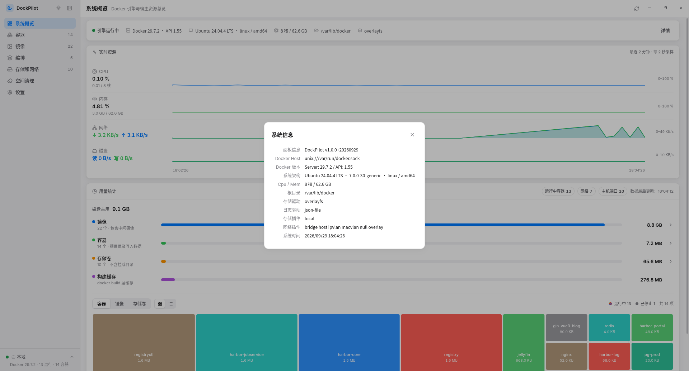
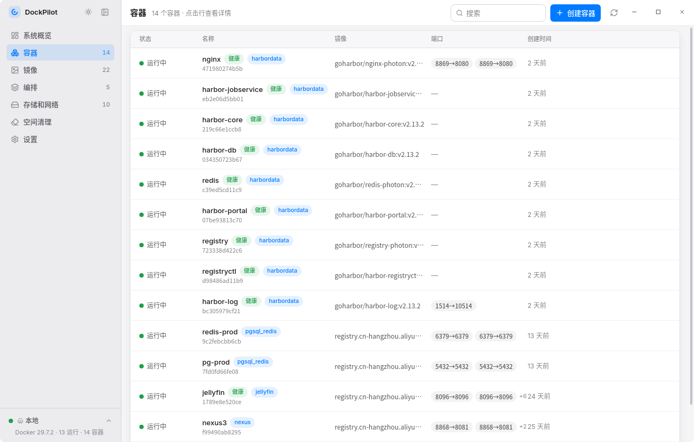
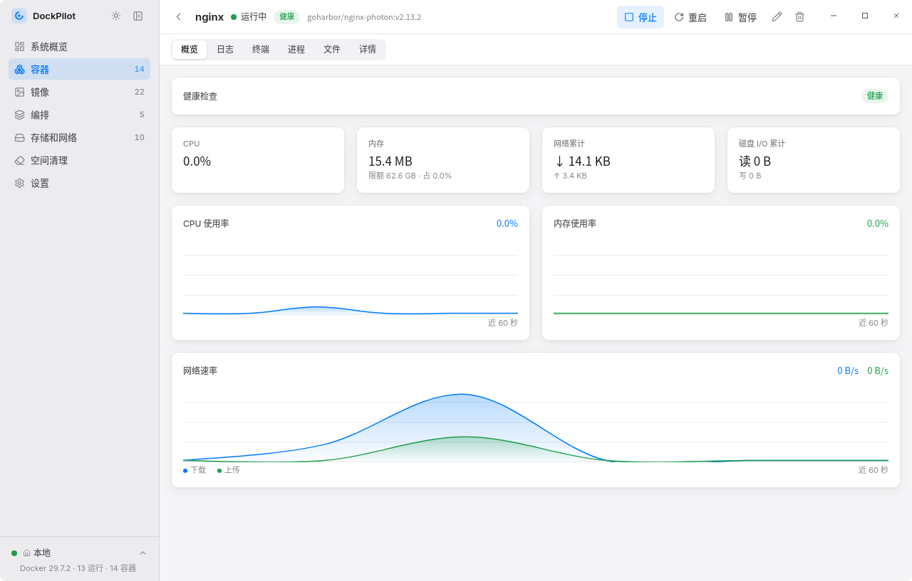
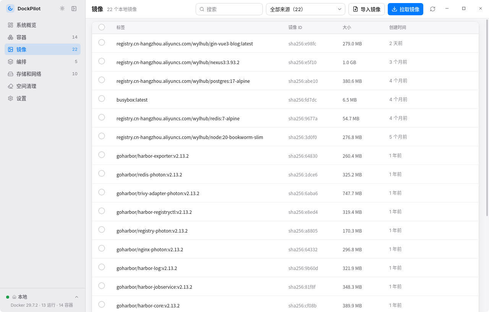
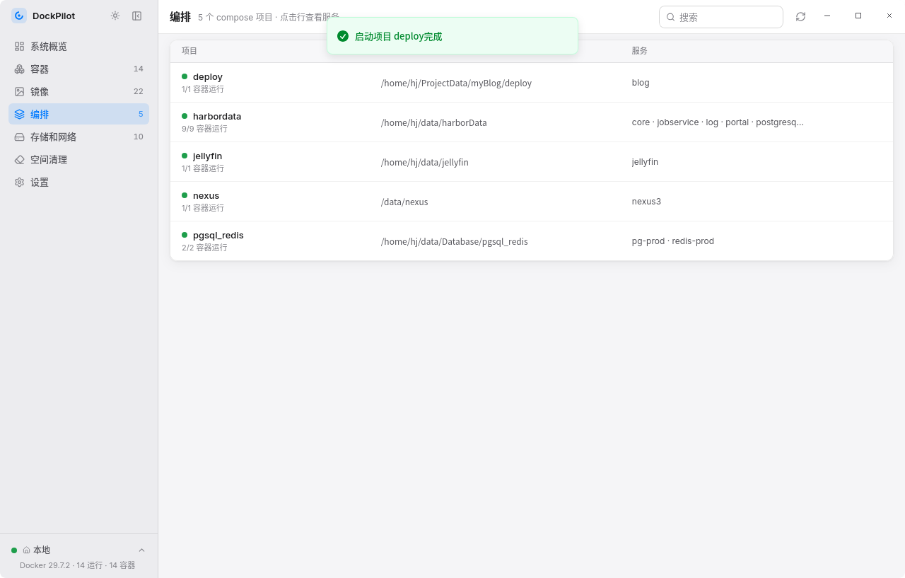
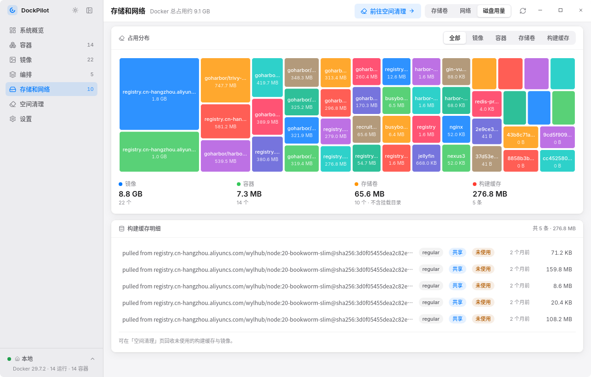
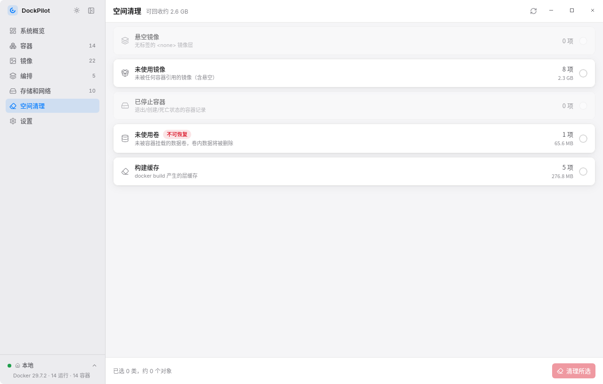
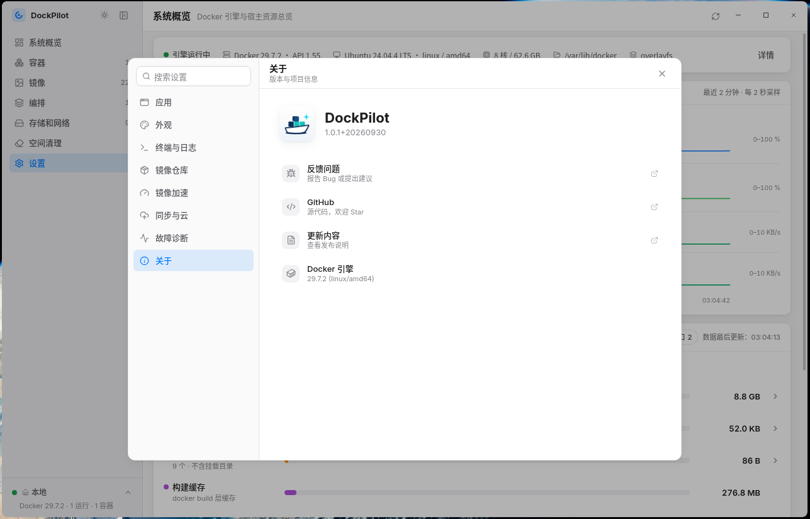
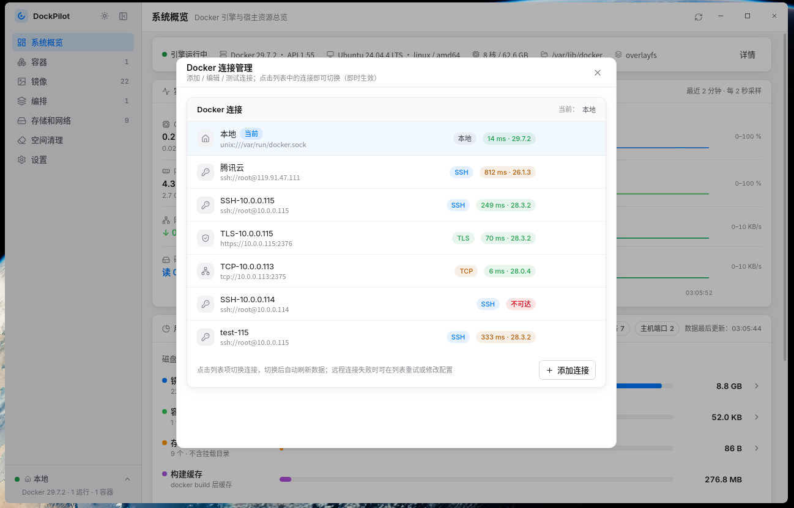

# DockPilot

**Docker Desktop Manager** — Containers · Images · Compose · Storage & Networks · Remote connections, all in a single installer

Local socket · SSH tunnel · TLS · plain TCP · Linux · Windows

[简体中文](README.md) | English

[](LICENSE)
[](https://github.com/WuYiLingOps/dockpilot/releases)
[](https://tauri.app)
[](https://rustup.rs)
[](https://react.dev)

**Project links**: [GitHub](https://github.com/WuYiLingOps/dockpilot) · [Gitee](https://gitee.com/WuYiLingOps/dockpilot)

Most Docker management tools (Portainer, Dockge, etc.) are web apps: you deploy a containerized service first, then open it in a browser — managing Docker starts by putting an extra burden on Docker itself.

DockPilot packs the same capabilities into a desktop app: a Tauri 2 single window + a Rust core that talks to the Docker Engine API directly. Manage local or remote Docker without deploying anything. One installer and you're up and running: nothing to deploy, no ports to occupy, no login. Connection credentials and registry passwords stay on your machine — SSH supports passwords (kept in the OS keyring / an encrypted file) or private keys, and registry passwords go into the OS keyring.

[Screenshots](#screenshots) · [What it can do](#what-it-can-do) · [How it works](#how-it-works) · [Tech stack](#tech-stack) · [Quick start](#quick-start) · [Build & install](#build--install) · [Project structure](#project-structure)

**User manual** (docs/, in Chinese): [Remote connections](docs/remote-connection.md) · [Pushing images](docs/push-images.md) · [Cloud sync](docs/cloud-sync.md) · [FAQ](docs/faq.md)

**Contributing & version history**: [CONTRIBUTING.md](docs/CONTRIBUTING.md) · [CHANGELOG.md](CHANGELOG.md) (in Chinese)

---

## Screenshots

> The screenshots show the Chinese UI. Since v1.0.6 the app itself ships with an English interface (Settings → Appearance → UI language).

**System overview**



**Containers**



**Container details**



**Images**



**Compose**



**Storage and networks**



**Space cleanup**



**Settings**



**Connection manager**



An OrbStack-style layout: sidebar navigation (the top button collapses it into an icon rail, remembered locally) + click through to detail pages, with logs, terminal and monitoring folded into detail-page tabs; light / dark themes (follow the system) and a custom integrated title bar. Window corners use an 8px Fluent radius: Linux via a transparent window + CSS clipping, Windows 11 via native DWM rounded corners (with anti-aliasing and shadow; Windows 10 has no native rounded-corner API and shows square corners), automatically reverting to square when maximized or fullscreen.

## What it can do

- **Containers** — list / search / start / stop / restart / pause / unpause / remove, refreshed in real time by Docker events; healthcheck badges (healthy / unhealthy / checking); compose containers carry a project badge that jumps straight to the compose detail page
- **Container creation** — image selection (auto-pull with progress when missing locally), container name (leave empty to auto-generate), port mappings (multi-line, tcp/udp), volume mounts (multi-line, read-only), environment variables, labels, resource limits (memory MB/GB, fractional CPU cores), command override (parsed by shell lexing), working directory, network selection, hostname, restart policy, auto-remove / privileged / TTY / stdin, on par with Docker Desktop's Run; paste a `docker run` command to auto-parse and fill the form (-p/-v/-e/-l/--name/--restart/--memory/--cpus and other common options), plus clone an existing container (inspect reverse-parsed into the form, compose labels stripped; if the source container is running, the clone automatically switches to a no-restart policy and warns about port / volume conflicts, so the clone doesn't get stuck in a restart loop)
- **Container details** — overview (live CPU / memory / network / disk I/O charts, CPU / memory limits and share, healthcheck status with the latest failure output; when not running, shows exit code / OOM and other exit reasons with troubleshooting hints, and an instantly-failing start is reported right in the action hint), logs (streaming, auto-follow, keyword filter, timestamps, stderr highlight, export to file with current parameters), terminal (interactive bash / sh / ash, resize-aware), processes (live docker top table), files (browse / upload / download / delete, equivalent to docker cp; directory listing and deletion require a running container), raw Inspect JSON viewer (keyword filter, one-click copy); supports online config updates (docker update for restart policy and memory / CPU limits, no container recreation needed)
- **Images** — list / search / source filter (grouped by image address prefix) / remove (force available) / pull (live progress, latest tag auto-appended when omitted, registry credentials auto-matched by image source); tar archive export (batch, shared-layer dedup, cancellable) and import (multiple images), tag management with per-tag removal; push to private registries, with multi-select batch push (per-row auto-derived target references, sequential pushes, one failure doesn't block the rest — see "[Pushing images](docs/push-images.md)")
- **Compose (docker compose)** — compose projects are auto-detected from standard container labels and aggregated by service; stopped projects stay manageable: previously-run projects are remembered (still visible and one-click restartable after `down`), with manual compose file registration (local file picker or SSH remote path) and directory scanning (auto-discovery), badges distinguishing sources; project-level start / stop / restart / pause / down (optionally removing volumes and images) / build / pull, service-level start/stop and restart, streaming output that can be cancelled mid-run; compose files editable in place (syntax precheck, automatic backup, re-apply). Calls the system compose CLI (plugin and standalone builds auto-detected; view-only with a hint when not installed)
- **Storage and networks** — volumes (list / detail with mount points and using containers / create / delete, usage and reference counts from `docker system df`), networks (detail with IPAM and connected containers / create / delete / connect-disconnect containers, built-in networks protected from deletion), disk usage (share treemap, build cache breakdown, jump to space cleanup), volume / network data refreshed by events
- **System overview** — Docker engine and host resource summary: basics, container CPU / memory usage, live network and disk charts, usage treemap; the "volumes / networks" stat cards jump to their sub-tabs
- **Space cleanup** — size and count stats for dangling images / unused images / stopped containers / unused volumes / build cache, check-and-clean with reclaimed space shown
- **Multi-connection management** — config, connectivity test (latency & version), add / edit / delete for multiple Docker connections, one-click switching that takes effect immediately; quick switcher at the sidebar bottom. SSH tunnels are established by the app's built-in engine (password or key, rootless socket) — see "[Remote connections](docs/remote-connection.md)"
- **Registry credentials** — credential management and connectivity tests for Docker Registry v2 compatible registries such as Alibaba Cloud ACR and self-hosted Harbor (generic registries accept `docker.io`, `ghcr.io`, `quay.io` and other official sources), passwords stored in the OS keyring; used for pushing images and auto-matched on pull (see "[Pushing images](docs/push-images.md)")
- **SSH credential keyring** — two kinds of reusable credentials: **keyring private keys** (import from file or paste PEM, public key fingerprint and public key derived automatically, referenced by multiple connections, resolved in memory at connect time with no dependency on local paths) and **identities** (username + password + optional linked private key); both sync across devices via cloud sync (on by default, can be turned off) — see "[Remote connections](docs/remote-connection.md)"
- **Multi-device cloud sync** — connection configs, SSH keyring entries & credentials (on by default, can be turned off), registry entries and display settings are end-to-end encrypted and synced to your own GitHub private Gist, merged automatically across devices; the cloud only ever holds ciphertext (plaintext credentials live inside the sync password's encryption envelope), the sync password is remembered in the local keyring once unlocked and auto-unlocks at startup (can be locked and cleared anytime) — see "[Cloud sync](docs/cloud-sync.md)"
- **Background resident** — lives in the system tray; closing the window the first time pops a prompt asking "minimize to tray / quit" (remember-choice checkbox, changeable anytime in Settings → App → When closing the window); after minimizing, desktop notifications for abnormal containers keep working; single instance, a second launch raises the existing window
- **Settings** — theme, UI language (system / 简体中文 / English), connection manager, registry credentials, multi-device cloud sync, list refresh interval, log & terminal defaults, desktop notifications for abnormal containers, close-window behavior (ask every time / minimize to tray / quit), diagnostics (usage log viewer, debug logging toggle, scheduled log cleanup, diagnostic bundle export), persisted to `~/.config/com.dockpilot.app/settings.json`
- **Registry mirror / daemon.json editor (Linux)** — Docker Desktop-style full-file editing of `/etc/docker/daemon.json` (pkexec privileged write, automatic backup before overwrite), live validation (JSON syntax + semantic checks + dockerd `--validate` deep validation, auto-downgraded on older Docker), built-in quick toggles for preset China mirrors, one-click speed test, falling back to a copyable terminal command when pkexec is unavailable

### What it is not

__It is not__ a container orchestration platform — it targets a single Docker daemon (local or remote) and does no Swarm / Kubernetes multi-cluster orchestration; __nor__ an image build tool — no build pipelines; __and not__ a resident service — after a full quit it leaves no background process on any host; tray-minimizing is a user-chosen desktop background mode, and the tray menu quits in one click.

### When to use it

| Scenario | Traditional web approach | DockPilot |
| :--- | :--- | :--- |
| Manage local Docker | Deploy a Portainer container, access via browser | Install and run, connects straight to the local socket |
| Manage remote Docker | Open port 2375 on the remote host, or deploy another service | Encrypted SSH tunnel, zero setup on the remote host |
| Offline / strict intranet | Service and browser must interconnect | Desktop app runs locally, credentials never leave the machine |
| Consistent config across devices | Config on a server, or manual export/import | Sync to your own GitHub private Gist, end-to-end encrypted with auto-merge |

## How it works

```
 React 19 UI ◄── Tauri IPC / Channel ──► Rust + tokio backend
                                               │
                         ┌─────────────────────┼─────────────────────┐
                         ▼                     ▼                     ▼
                     bollard              secret_store           daemon_config
                 (Docker Engine API)   (keyring / encrypted    (privileged daemon.json
                                        file)                  access)
                         │
        ┌────────────────┼────────────────┐
        ▼                ▼                ▼
    local socket      SSH tunnel      TLS / plain TCP
   (Linux local)   (zero remote      (2376 / 2375)
                     setup)
        └────────────────┼────────────────┘
                         ▼
           Docker Engine (local / remote)

   Compose does NOT go through the Engine API — it runs the system compose CLI as a subprocess:
                                               │
                         ┌─────────────────────┴─────────────────────┐
                         ▼                                           ▼
               local / direct connection                       SSH connection
   (subprocess gets DOCKER_HOST pointing         (executed on the remote host through
    at the current Engine)                        the built-in russh engine — no local
                                                  Docker installation needed)
```

- **Who does what** — the frontend only renders and interacts; connections to the Engine are owned by the Rust backend, and all Docker operations, streaming progress and event listening run in Tokio tasks
- **How connections are built** — each entry in settings is a connection config; switching rebuilds it immediately and auto-cancels streams on the old connection; SSH brings up an encrypted tunnel locally (Linux socket forwarding / Windows TCP forwarding), the tunnel is reclaimed on connection switch and app exit, and rebuilt automatically on next use after a crash
- **How commands run** — Docker operations go through bollard (Engine API); compose runs the system CLI (plugin and standalone auto-detected): local / direct connections get `DOCKER_HOST` injected, SSH connections execute directly on the remote server via SSH — no local Docker installation needed
- **How data refreshes** — lists are invalidated and refreshed by pushed Docker events; long-lived streams (logs, stats, terminal) are pushed over Tauri Channels with a unified cancellation registry — switching pages stops the stream, no orphaned tasks
- **How secrets are stored** — SSH passwords / key passphrases are encrypted via the OS keyring (falling back to a machine-bound encrypted file when no keyring exists); private keys only store paths; registry passwords also prefer the OS keyring; push / pull sends the password to the daemon via request headers — never written to `~/.docker/config.json` or the remote disk

## Tech stack

| Layer | Choice | Notes |
|---|---|---|
| Desktop framework | Tauri 2 | System-native WebView (WebKitGTK on Linux, WebView2 on Windows); installer size and memory footprint far below Electron |
| Backend | Rust + bollard | Async Rust client for the Docker Engine API; local Unix socket on Linux, TCP / TLS / SSH tunnel for remote |
| Frontend | React 19 + TypeScript + Tailwind CSS 4 | Built with Vite |
| Terminal | @xterm/xterm | Bridged to the backend exec stream over a Tauri Channel |
| State | TanStack Query + Docker events | List data auto-invalidated by pushed events |

## Quick start

**Prerequisites**: [Rust](https://rustup.rs) ≥ 1.90 and Node.js ≥ 20 (development builds). Linux needs Ubuntu 22.04 / 24.04 (other distros theoretically work, unverified); Windows 10 / 11 supports remote connections only (SSH / TLS / plain TCP).

```bash
git clone https://github.com/WuYiLingOps/dockpilot.git
cd dockpilot
npm install
npm run tauri dev
```

Linux needs the WebKitGTK build dependencies, and the current user must be able to access the Docker socket (join the docker group and re-login):

```bash
sudo apt install libwebkit2gtk-4.1-dev build-essential curl wget file \
  libxdo-dev libssl-dev libayatana-appindicator3-dev librsvg2-dev

sudo usermod -aG docker $USER
```

**Just want to see the UI**: `npm run dev` opens the browser preview (http://localhost:1420, theme toggle to try light/dark). `public/tauri-mock.js` activates automatically in non-Tauri environments (no `__TAURI_INTERNALS__`) and feeds the frontend fake data — it's fully inert in the real desktop app. Frontend-only changes don't need Rust running.

**Tests**:

```bash
cd src-tauri
cargo check          # type check
cargo test           # unit + integration tests (requires a local Docker daemon)
npm run build        # frontend tsc + vite build
```

Regression tests for remote paths beyond the local daemon are ignored by default; see "Remote connection integration tests" in [docs/remote-connection.md](docs/remote-connection.md) (Chinese) for how to run them. Windows CI only runs tests that don't depend on a local Docker daemon.

## Build & install

### Option 1: download an installer (recommended)

Download the installer for your platform from [Releases](https://github.com/WuYiLingOps/dockpilot/releases):

- **Linux deb** (`DockPilot_<version>_amd64.deb`): Debian-based systems like Ubuntu 22.04 / 24.04, `sudo apt install ./DockPilot_*_amd64.deb` or double-click to install
- **Windows NSIS installer** (`DockPilot_<version>_x64-setup.exe`): setup wizard, creates Start menu / desktop shortcuts automatically
- **Windows portable** (`DockPilot_<version>_x64_portable.exe`): a single exe, no installation — drop it anywhere and double-click; deleting the file uninstalls it. Shares the same config data as the installed version and can swap seamlessly; requires the WebView2 runtime (preinstalled on Windows 11)

All Windows packages currently ship without code signing; SmartScreen may show an unknown-publisher prompt on first run ("More info → Run anyway"). The Windows build supports remote connections only (SSH / TLS / TCP).

### Option 2: build locally

On Linux use `management.sh` to build the deb; on Windows use `management.ps1` to build the NSIS installer (release Windows installers are built by GitHub Actions on a Windows runner). Both one-click scripts handle version sync, packaging, install and uninstall; the PowerShell version additionally ships `dev` / `test` / `cargo-test` / `check` / `clippy` shortcuts:

```bash
./management.sh build           # build the deb (current project version)
./management.sh build 0.3.4     # sync the version number, then build the deb
./management.sh version 0.3.4   # sync version numbers only, no build
./management.sh install         # install the latest deb (sudo elevated automatically)
./management.sh uninstall       # uninstall dock-pilot
```

Windows (PowerShell 5.1+; if blocked by execution policy, run `powershell -ExecutionPolicy Bypass -File .\management.ps1 <command>`):

```powershell
.\management.ps1 build           # build the NSIS installer (current project version)
.\management.ps1 build 0.3.4     # sync the version number, then build the NSIS installer
.\management.ps1 version 0.3.4   # sync version numbers only, no build
.\management.ps1 install         # silent-install the latest NSIS installer (-Yes skips the overwrite/upgrade confirm)
.\management.ps1 uninstall       # silent-uninstall DockPilot
```

- Both scripts' `version <x.y.z>` syncs `package.json`, `package-lock.json`, `Cargo.toml`, `Cargo.lock` and `tauri.conf.json`; `build <x.y.z>` runs the same sync first
- `build` cleans old artifacts and appends the current date to the version (e.g. `0.3.1+20260925`) for traceability and overwrite installs; during the build the scripts temporarily override project-local and user-global Cargo configs to inject registry mirrors — pair the matching `replace-with` and `registry` parameters per the in-script comments when switching (Linux injects via `--config` on the Cargo command line; Windows injects via `CARGO_*` environment variables because the tauri CLI doesn't go through `.cmd` wrappers — same effect)
- The Windows script pre-checks Node / Rust / WebView2 Runtime / MSVC C++ build tools and restores missing PATH entries and `CARGO_HOME` / `RUSTUP_HOME` from the registry (Rust and Node in custom directories are recognized); install / uninstall use NSIS silent mode (`/S`), triggering UAC automatically when admin rights are needed
- Manual route: Linux `npm run tauri build -- --bundles deb` (same as `management.sh build`), deb artifact in `src-tauri/target/release/bundle/deb/` (deb package name `dock-pilot`), e.g. `sudo apt install ./DockPilot_0.3.1_amd64.deb`; Windows `npm run tauri build -- --bundles nsis` (same as `management.ps1 build`), artifacts in `src-tauri/target/release/bundle/nsis/`
- The Windows NSIS installer ships a shortcut icon refresh hook (`src-tauri/windows/installer-hooks.nsh`): after an upgrade install it rewrites existing desktop / Start menu shortcuts and tells the system to flush the icon cache, so shortcuts don't keep showing the old version's icon (Windows caches icons per exe path, and an upgrade install doesn't recreate shortcuts)

**Run the local build directly** (no deb install needed):

```bash
npm run tauri build
./src-tauri/target/release/dockpilot
# Debug build: src-tauri/target/debug/dockpilot (cargo build output)
```

**Wayland taskbar icon**: on Wayland the taskbar icon matches the window app-id against `.desktop` files; dev mode has no desktop entry so the taskbar shows a generic icon. Registering the debug binary as a user-level app fixes it:

```bash
mkdir -p ~/.local/share/applications
REPO=$PWD   # repo clone directory, adjust to your actual path
cat > ~/.local/share/applications/dockpilot-dev.desktop <<EOF
[Desktop Entry]
Categories=Development;Utility;
Comment=DockPilot dev mode (debug binary)
Exec=$REPO/src-tauri/target/debug/dockpilot
StartupWMClass=dockpilot
Icon=$REPO/design/app-icon.png
Name=DockPilot (Dev)
Terminal=false
Type=Application
EOF
update-desktop-database ~/.local/share/applications
```

- Adjust `Exec` and `Icon` to your actual repo path; the app window's app-id is the binary name `dockpilot`
- **Delete the file after installing the real deb** (`rm ~/.local/share/applications/dockpilot-dev.desktop`) to avoid matching ambiguity with the installed version (`StartupWMClass=dockpilot`)

## Remote connections

Manage multiple Docker connections and switch at will: Linux supports **local socket / SSH / TLS / plain TCP**, Windows supports **SSH / TLS / plain TCP**; SSH tunnels are established by the app's built-in engine (password or key, rootless socket) — zero setup on the remote host. Setup steps, a hands-on TLS certificate walkthrough and troubleshooting are covered in **[docs/remote-connection.md](docs/remote-connection.md)** (Chinese).

## Pushing images

Push local images to Docker Registry v2 compatible registries, with first-class support for Alibaba Cloud ACR and self-hosted Harbor; credentials live in the OS keyring, with multi-select batch push and push-error reference. Usage and security notes in **[docs/push-images.md](docs/push-images.md)** (Chinese).

## Cloud sync

Config sync across devices: connection configs, registry entries and display settings are end-to-end encrypted and stored in your own GitHub private Gist — the cloud only holds ciphertext. Usage, sync scope and safety rails in **[docs/cloud-sync.md](docs/cloud-sync.md)** (Chinese).

## FAQ & known notes

Crash troubleshooting and log locations, Linux black screen, tray icon, Alpine terminals, file tab limitations, Windows local Docker, daemon.json permissions, registry password storage and sync password recovery — see **[docs/faq.md](docs/faq.md)** (Chinese).

## Project structure

```
design/
├── app-icon.svg              # icon vector source (helm wheel + shipping container)
├── app-icon.png              # 1024px rendered source image
└── icon-design-philosophy.md # icon design philosophy
screenshots/                  # README screenshots
src-tauri/
├── icons/                    # generated by `npx tauri icon design/app-icon.png`
├── windows/
│   └── installer-hooks.nsh   # NSIS install hook: refresh shortcuts & system icon cache after upgrade installs
└── src/
    ├── lib.rs                # app entry: single instance, system tray & close interception, state registration, global event listeners, command registration
    ├── main.rs
    ├── settings.rs           # app settings read/write (connection & registry credential models, legacy config migration & sanitizing)
    ├── i18n.rs               # UI language infrastructure: global language state + zh/en message table, tray menu building
    ├── secret_store.rs       # credential key storage: OS keyring first, machine-bound AES-256-GCM encrypted file fallback
    ├── registries.rs         # registry credential CRUD & connectivity tests (/v2/ probe + Bearer/Basic dispatch)
    ├── github_sync.rs        # cloud sync Rust bridge: GitHub Device Flow, Gist raw fallback download, token keyring storage
    ├── daemon_config.rs      # registry mirror: daemon.json full-file read/write / validate / pkexec elevation / speed test
    ├── cleanup.rs            # space cleanup: disk usage stats and prune operations
    └── docker/
        ├── conn.rs           # multi-connection management & runtime switching, connection cache, four transports
        ├── ssh_client.rs     # built-in SSH engine (russh): password/key auth, tunnel forwarding, remote execution
        ├── ssh_known_hosts.rs # SSH host fingerprint TOFU storage & confirmation
        ├── dto.rs            # serialization structs sent to the frontend
        ├── state.rs          # stream cancellation handle registry + terminal session table
        ├── system.rs         # docker_info / host_stats / system_df (with build cache breakdown)
        ├── containers.rs     # container list / lifecycle ops / create-and-start (Docker Desktop Run parity)
        ├── networks.rs       # network list (with connection details & IPAM) / create / delete / connect-disconnect containers
        ├── volumes.rs        # volume list (merged df usage & container mounts) / create / delete
        ├── compose.rs        # compose: label-based project detection + local tracking (stopped project memory / manual registration / directory scan) + compose CLI invocation (DOCKER_HOST injection locally / SSH remote execution, streaming output)
        ├── images.rs         # image list / delete / pull (credentials auto-matched by source) / export-import (save & load streaming) / tag management
        ├── push.rs           # image push (credentials passed to the daemon via X-Registry-Auth header, auto-retag, streaming progress)
        ├── logs.rs           # log streams
        ├── stats.rs          # resource stats streams (CPU/memory/network/block I/O conversion, CPU limit normalization)
        ├── exec.rs           # interactive terminal (exec + stdin + resize)
        └── events.rs         # global Docker event listener & subscription forwarding (rebuilt on connection switch)
src/
├── components/               # Sidebar (with connection switcher), TitleBar, shared UI components, compose/ output panel, containers/ create modal, detail/ detail-page views
├── components/overview/      # pure-SVG charts for system overview (donut / line / treemap)
├── components/settings/      # connection manager, registry credentials, cloud sync & mirror settings groups
├── pages/                    # overview / containers / images / container detail / compose / compose detail / storage & networks / cleanup / settings
├── hooks/                    # container action mutations, compose output stream, cloud sync automation (startup check / debounced trigger)
├── lib/api.ts                # Tauri invoke wrapper (streaming commands return cancel functions)
├── lib/i18n/                 # UI language: zh/en dictionaries, module-level language store, t()/useT
├── lib/sync/                 # cloud sync: encryption (AES-256-GCM + PBKDF2), three-way merge, Gist adapter, sync engine (anchor / guardrails)
├── lib/settings.ts           # settings query/mutation, connection switch mutation, theme migration
├── lib/registries.ts         # registry credential query/mutation hooks
├── lib/theme.ts              # theme tri-state store (system / light / dark)
├── lib/format.ts             # byte / time / port formatting
└── types/                    # TS types mirroring the Rust DTOs one-to-one
```

## Versioning & releases

The version number lives in `package.json`, `Cargo.toml` and `tauri.conf.json`; `./management.sh version <x.y.z>` (Linux) / `.\management.ps1 version <x.y.z>` (Windows) syncs it in one shot. Release assets include the Linux deb and Windows NSIS installer / portable exe; per-version changes and installers are on the [Releases](https://github.com/WuYiLingOps/dockpilot/releases) page.

## Acknowledgements

| Project | Used for |
|---|---|
| [Tauri](https://tauri.app) | Desktop framework & IPC |
| [bollard](https://github.com/fussybeaver/bollard) | Async Docker Engine API client |
| [TanStack Query](https://tanstack.com/query) | Server state & cache invalidation |
| [Tailwind CSS](https://tailwindcss.com) | UI styling |
| [xterm.js](https://xtermjs.org) | Interactive terminal |
| [lucide](https://lucide.dev) · [sonner](https://sonner.emilkowal.ski) | Icons & toasts |

## License

[MIT](LICENSE)

## Feedback

Found a bug or have an idea? Open a [GitHub Issue](https://github.com/WuYiLingOps/dockpilot/issues) or a [Gitee Issue](https://gitee.com/WuYiLingOps/dockpilot/issues) (either language works). If DockPilot helps you, a ⭐ Star is much appreciated.
